  

 

  <h1>BugNaRok</h1>
  
<code>&lt;/&gt; CHAOS ENGINEER</code>

  

    Builder and chaos engineer from Brittany (BZH). 
    I work with Rust, TypeScript, Python, Wasm, Go, C++, Node.js, and Elixir: from web apps to self-hosted infra.
  

  

    
    
    
    
    
    
    
    
    
  

## Projects

<ul>
<li><strong><a href="https://bugnarok.dev">BUGNAROK</a></strong>: Personal landing and terminal.</li>
<li>

<strong>WaspSoC</strong>: The System-on-Chip for sovereign AI agents.

WaspSoC is a sovereign, ultra-fast WebAssembly runtime for AI agents, written in 100% Rust. It replaces Docker, KVM and heavyweight container runtimes with WASI (WebAssembly System Interface, Preview 2): a fast, secure and economical substrate for running sovereign AI agents.

</li>
<li><strong>Hubbl</strong>: Signal intelligence: editorial engine and public surface.</li>
<li><strong><a href="https://mnemos.rest">Mnemos</a></strong>: Sovereign memory for Hermes Agent.</li>
<li><strong>ENS CCIP-Read resolver</strong>: Self-hosted CCIP-Read resolver for ENS, written in Rust.</li>
</ul>

## Links

- X: [@bugnarokdev](https://x.com/bugnarokdev)
- Site: [bugnarok.dev](https://bugnarok.dev)

## Contributions

  
   
  <a href="https://bugnarok.dev">Jouer sur bugnarok.dev</a>

 

  <code>BNK // SYSTEM 001 // BZH</code>

